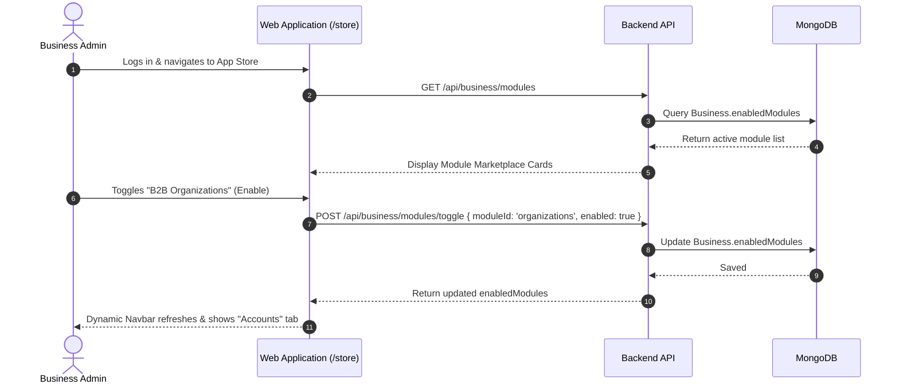
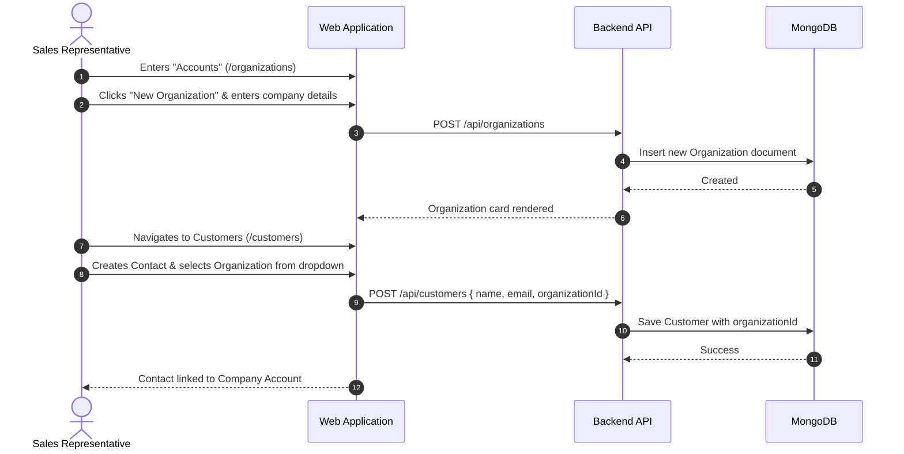
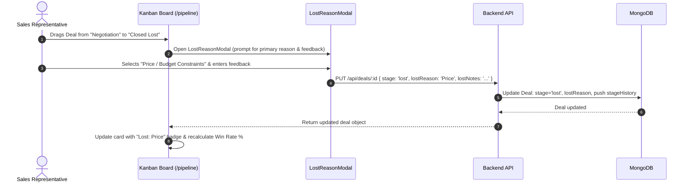
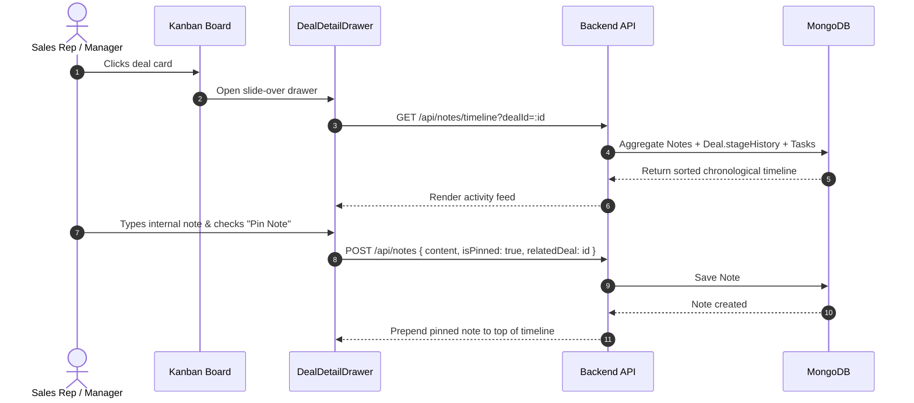
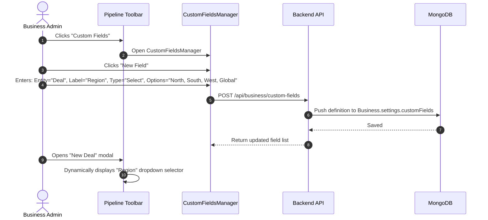

# CRM Platform: Features & End-to-End User Flows

This document details all features of the modular SaaS CRM platform and outlines the step-by-step user journeys and workflows.

---

## 1. Complete Feature Catalog

### 🛍️ 1. SaaS App & Plugin Marketplace (`/store`)
- **Tenant Modularity**: Businesses can activate or deactivate plugins on demand without breaking data or requiring database migrations.
- **Available Modules**:
  1. `sales_pipeline`: Deals Kanban, probability forecasting, stage history.
  2. `organizations`: B2B accounts, multi-contact linking, corporate revenues.
  3. `campaigns`: Marketing broadcast campaigns, audience segmentation.
  4. `orders`: Purchase tracking, customer lifetime value updates.
  5. `ai_insights`: Google Gemini AI growth roadmaps and marketing suggestions.
  6. `tasks`: Action items, follow-up calls, reminders, and checklist statuses.
- **Dynamic Navigation**: Navigation links, routes, and action buttons dynamically render based on active modules.

### 🎯 2. Sales Pipeline & Deals (`/pipeline`, `/forecast`, `/pipeline-settings`)

> **This cycle:** pipeline stages are now tenant data (`Pipeline` collection) served by
> `GET /api/pipelines`. Stage probability drives the weighted forecast, a lost deal
> requires a reason, the board supports drag and drop, the loss-reason breakdown is
> rendered, and a new **Forecast** page buckets pipeline by expected close period.
- **6-Stage Visual Kanban**: `Lead In` ➔ `Contacted` ➔ `Proposal Sent` ➔ `Negotiation` ➔ `Closed Won` / `Closed Lost`.
- **Metrics Bar**: Total pipeline value, probability-weighted sales forecast (`value × probability %`), win rate %, and active deal counts.
- **Micro-Actions**: 1-click stage advancement, priority pill badges, search, and priority filter.
- **Slide-Over Detail Drawer**: Clicking any card pulls out a side panel displaying the complete deal dossier, overview, activity stream, and tasks.

### 🏛️ 3. B2B Organizations & Corporate Accounts (`/organizations`)
- **Corporate Directory**: Track companies, websites, employee headcount, annual turnover, industry classification, phone, and address.
- **Rollup Metrics**: Automatically computes linked contact counts and combined pipeline deal value per organization.
- **Multi-Contact Association**: Links multiple individual customer contacts to a parent company.

### 🛑 4. Deal Loss Intelligence (`crm_lost_reason`)
- **Lost Reason Modal**: Triggered when a deal transitions to "Closed Lost".
- **Structured Categories**: Budget constraints, Competitor won, Missing critical features, Project timing delay, Client unresponsive, or Custom reason.
- **Loss Analytics**: Aggregated in pipeline metrics to help sales leadership identify systemic bottlenecks.

### 📝 5. Notes & Activity Timeline Feed (`/api/notes`)
- **Internal Annotations**: Sales reps and managers can post sticky notes on deals and customers.
- **Pinning**: Pin critical discussion notes to the top of the feed.
- **Chronological Timeline**: Unified audit trail combining internal notes, stage transition history (with user attribution and timestamps), and linked tasks.

### ✅ 6. Tasks & Follow-ups Management (`/tasks`)
- **Checklist Workflow**: Manage to-dos, scheduled calls, demos, and follow-ups.
- **Priority & Due Dates**: Filter by status (`todo`, `in_progress`, `completed`) and priority (`high`, `medium`, `low`). Overdue tasks highlighted with alert badges.
- **Direct Deal & Contact Linking**: Associate tasks with a specific customer or deal.

### ⚙️ 7. Dynamic Custom Fields Engine
- **No-Code Field Creation**: Admins can add dynamic attributes (`text`, `number`, `select`, `date`) to Deals, Customers, or Organizations.
- **Automatic Form Rendering**: Newly created custom fields instantly appear in creation modals and detail drawers.

### 📢 8. Marketing Campaigns & Segments (`/campaigns`, `/campaign-history`)

> **This cycle:** segmentation uses a closed vendor-neutral rule DSL
> (`{ "totalSpend": { "gte": 5000 } }`) instead of raw Mongo operators, the audience
> preview is resolved server side by `POST /campaigns/preview`, reusable **email
> templates** were added, every send carries a `List-Unsubscribe` header and a signed
> one-click unsubscribe link, and suppressed recipients are logged as `SKIPPED`.
- **Targeted Audiences**: Segment customers by total spend, order count, or last purchase date.
- **HTML Email Simulator**: Broadcast personalized emails to segmented customer cohorts with delivery status logging.

### 📈 9. AI Growth Intelligence (`/reports`)

> **This cycle:** the AI routes now require an authenticated, write-capable caller, and
> the Gemini model identifier falls back through a candidate list because
> `gemini-2.0-flash` was retired.

### 🔥 10. Lead Lifecycle & Scoring (`/leads`)

> **This cycle:** contacts carry a lifecycle stage (`lead → contacted → qualified →
> customer → churned`), a source, a 0-100 score and a cold/warm/hot band. The score is
> recalculated from business email, linked company, order count and lifetime spend on
> every write, and a lead can be converted to a customer or rescored on demand.

### ⚡ 11. Workflow Automation (`/workflows`)

> **This cycle:** workflows watch for a domain event, check a condition written in
> a safe expression language, and run a list of actions. Ten actions are available
> (create a task, update the record, send an email, send a notification, assign the
> record, adjust the lead score, set the lead temperature, create a deal, add a
> note, wait). Wait steps park a run in the database so a sequence survives a
> restart, every run is recorded with its per-step outcome, and workflows can
> write in-app notifications.

### 🗂️ 12. Audit Trail & Activity History

> **This cycle:** every create, update and delete on a tenant record is written to an
> `AuditLog` collection with a field-level before/after diff, the actor, role, IP and
> user agent. The deal drawer timeline merges notes, stage transitions, linked tasks
> and audit entries, and `GET /api/audit` exposes a tenant-wide activity feed.

### 🔎 13. Global Search (`GET /api/search`)

> **This cycle:** the command palette (Cmd/Ctrl+K) queries contacts, deals, accounts and
> tasks in one call, instead of only matching navigation entries.
- **Gemini AI Integration**: Analyzes revenue trends, order velocity, and customer spending habits to generate an actionable 3-point business growth plan.

---

## 2. End-to-End User Flows

### Flow 1: Tenant Onboarding & Plugin Setup

---

### Flow 2: B2B Account & Contact Association Flow

> The contact form now includes a company selector, so a contact can be linked to a
> B2B account from the UI. It did not previously.

---

### Flow 3: Sales Pipeline Progression & Lost Reason Capture

> Drag and drop between columns is now implemented, alongside the existing arrow
> buttons and the stage progression bar in the deal drawer.

---

### Flow 4: Deal Detail Slide-Over & Timeline Notes Feed

---

### Flow 5: Dynamic Custom Field Configuration Flow

---

## 3. User Persona Journeys

### 💼 Persona 1: Sales Representative (Daily Execution)
- **Morning Review**: Opens `/home` for overall volume metrics, checks `/tasks` for urgent follow-up calls and meetings.
- **Pipeline Progression**: Moves deals through the Kanban stages on `/pipeline`. When on a customer call, opens the **Deal Detail Drawer** to review past notes, quote numbers, and log new conversation takeaways.
- **Closing**: Advances deals to **Closed Won** or records competitive intelligence via **LostReasonModal** if a prospect declines.

### 👔 Persona 2: Sales Manager (Supervision & Forecasting)
- **Forecast Monitoring**: Inspects the **Weighted Forecast** metric bar on `/pipeline` to forecast month-end revenue.
- **Account Health**: Reviews `/organizations` to analyze which corporate clients have the highest contract values and linked deal volumes.
- **Loss Analysis**: Evaluates lost deal reasons to coach representatives and identify product/pricing pushbacks.

### 🛠️ Persona 3: Business Administrator (Operations & Customization)
- **App Marketplace**: Visually enables or disables CRM modules on `/store` as company needs evolve.
- **Team Governance**: Invites new sales agents and assigns roles (`admin`, `manager`, `viewer`) on `/team`.
- **Form Tailoring**: Uses `CustomFieldsManager` to add specialized attributes for industries, regions, and contract categories.
