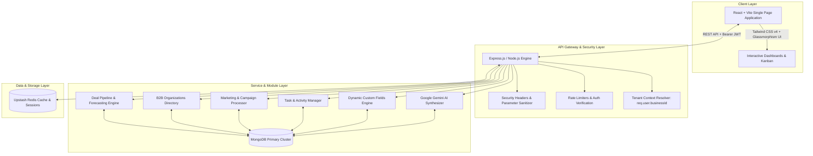
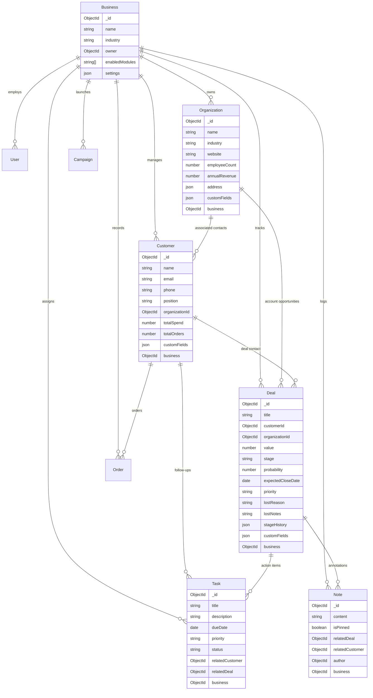
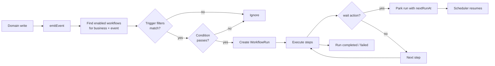

# System Design Document: Modular Multi-Tenant SaaS CRM

This document details the architectural design, multi-tenant isolation model, data schemas, caching strategies, and technical specifications for the Modular SaaS CRM platform.

---

## 1. High-Level Architecture

The CRM is designed as a **modular multi-tenant Software-as-a-Service (SaaS) platform**. Each business (tenant) operates with logical isolation, role-based access control, and dynamic feature toggles configured via an in-app marketplace.



---

## 2. Multi-Tenancy & Data Isolation Model

The platform enforces **Logical Multi-Tenancy with Tenant-Scoped Query Isolation**:

1. **Authentication & Identity**:
   - Every user belongs to a `Business` tenant (`user.businessId`).
   - Requests are authenticated via JWT bearer tokens containing `{ id, email, role, businessId }`.
   - The auth middleware verifies the JWT signature, **re-reads the user from MongoDB** so a role, status or tenant change takes effect immediately, blocks non-active accounts, and injects `req.user` into the Express execution context. Redis is used for caching and for the session store, not for token validation.

2. **Database Isolation**:
   - All tenant-specific collections (`Customer`, `Deal`, `Organization`, `Task`, `Note`, `Order`, `Campaign`, `CommunicationLog`, `Pipeline`, `AuditLog`, `EmailTemplate`, `Suppression`) include an indexed `business: ObjectId` reference to the `Business` model. `Campaign` and `CommunicationLog` previously used a `businessId` field; a boot-time migration backfilled the value and the legacy field is now read-only.
   - Database queries strictly filter by `business: req.user.businessId`, preventing cross-tenant data leakage.

3. **Dynamic Plugin Architecture (`enabledModules`)**:
   - Each `Business` document contains an `enabledModules: string[]` array (e.g. `['sales_pipeline', 'organizations', 'campaigns', 'orders', 'ai_insights', 'tasks']`).
   - Admins activate or deactivate plugins in `/store`.
   - The frontend gates **navigation items**, the home launchpad and the command palette on the tenant's enabled modules. Routes themselves are not gated, so a disabled module's URL stays reachable; gating routes is on the roadmap.

---

## 3. Database Schema & Data Models



### Core Schema Design Highlights
- **`Deal.stageHistory`**: Array of `{ stage, changedAt, changedBy }` creating an audit log of every pipeline movement.
- **`customFields` Map**: Stored as a dynamic `Map<string, any>` on `Deal`, `Customer`, and `Organization`, allowing runtime custom attribute extension without schema alterations.
- **`settings.customFields`**: Defines the metadata schema for custom attributes per business:
  ```json
  [
    {
      "id": "cf_1727140000_abc12",
      "entity": "deal",
      "label": "Contract Type",
      "key": "contract_type",
      "type": "select",
      "options": ["Annual Subscription", "Monthly", "Pilot POC"],
      "required": false
    }
  ]
  ```

---

## 4. Caching & Performance Architecture

### Redis In-Memory Layer (Upstash Redis)
1. **Customer & Directory Caching**:
   - `customers:<businessId>` cached with a 10-minute TTL, plus an organisation scoped
     variant `customers:<businessId>:<organizationId>`.
   - Cache invalidation occurs on any customer write (`POST`, `PUT`, `DELETE`) and
     removes **both** the unscoped and the affected organisation scoped keys.
2. **Dashboard Aggregates**:
   - `dashboard:summary:<businessId>` (5 min) and `dashboard:insights:<businessId>` (15 min).
   - Both are invalidated when a customer or order write changes revenue or contact counts.
3. **Session Storage**:
   - Express sessions are configured against Redis with an in-memory fallback. Note that
     `connect-redis` v9 expects a node-redis client while the configured client is the
     Upstash HTTP client, so the Redis store construction is wrapped in a try/catch and
     may fall back to the in-memory store. Verify before relying on server-side session
     revocation.
4. **Pipeline Summary Aggregations**:
   - Deal pipeline metrics use a MongoDB `$facet` aggregation to calculate total pipeline
     value, weighted forecasts, win rates, per-stage and per-owner breakdowns, and the
     loss reason breakdown in one round trip.
5. **Time Based Forecast**:
   - `GET /api/deals/forecast` groups open pipeline by expected close period with a
     `$dateToString` bucket and reports pipeline, weighted, won and lost value per period.

---

## 4b. Workflow Automation Engine

The workflow engine turns a domain event into a chain of actions.



**Expressions are parsed, never evaluated as code.** `backend/utils/expression.ts`
implements a recursive descent parser that produces an AST, and an evaluator that
walks the AST. `eval` and `new Function` are not used anywhere. Path resolution
refuses `__proto__`, `constructor` and `prototype`.

**Execution is off the request path.** `emitEvent` schedules the work with
`setImmediate`, so a workflow that sends mail never delays the write that
triggered it.

**Wait steps are restart safe.** A wait action stores the resume time on the run
document in MongoDB, and a scheduler (`services/workflowScheduler.ts`) picks up
due runs every thirty seconds. A process restart loses nothing.

**Re-entrancy is bounded.** A workflow cannot trigger itself: the engine keeps a
short-lived key of `(workflow, event, record)` it has already processed, and the
nesting depth of chained workflows is capped.

**Events are emitted from the domain controllers**, not from a generic hook, so
each event carries exactly the context that makes sense for it — a stage change
includes the previous stage, a status change includes the previous status.

| Event | Emitted from |
|---|---|
| `deal.created` | `dealController.createDeal` |
| `deal.updated`, `deal.stage_changed`, `deal.won`, `deal.lost` | `dealController.updateDeal` |
| `customer.created` | `customerController.createCustomer` |
| `customer.updated`, `customer.status_changed` | `customerController.updateCustomer` |
| `customer.converted` | `customerController.convertLead` |
| `task.created`, `task.completed` | `taskController` |
| `task.overdue` | the scheduler's overdue sweep |
| `note.created` | `noteController.createNote` |
| `campaign.sent` | `logController.simulateCampaignDelivery` |

**Every run is recorded** in the `WorkflowRun` collection with the trigger
context, the per-step outcome and any error, so a failed automation can be
inspected rather than guessed at.

---

## 5. Security & Role-Based Access Control (RBAC)

The application defines 3 role tiers:

| Permission / Action | Admin | Manager | Viewer |
| :--- | :---: | :---: | :---: |
| **Manage App Store Plugins** (`/store`) | ✅ | ❌ | ❌ |
| **Invite & Remove Team Members** (`/team`) | ✅ | ❌ | ❌ |
| **Configure Custom Fields** | ✅ | ❌ | ❌ |
| **Configure Pipeline Stages** | ✅ | ✅ | ❌ |
| **AI Intelligence & Reports** (`/reports`) | ✅ | ❌ | ❌ |
| **Create / Edit Deals & Tasks** | ✅ | ✅ | ❌ |
| **Delete Deals / Organizations** | ✅ | ❌ | ❌ |
| **View Pipeline, Customers & Accounts** | ✅ | ✅ | ✅ |
| **Post Internal Notes & Pin** | ✅ | ✅ | ✅ |
| **Delete a Note** | ✅ (any note) | ✅ (own note) | ✅ (own note) |
| **Run AI Segmentation / Insights** | ✅ | ✅ | ❌ |

### Security Measures Implemented
- **Parameter Pollution & SQL/NoSQL Injection Sanitization**: the request sanitiser strips
  every key that starts with `$` and every key containing a `.`, so raw Mongo operators
  can never reach a query. Business features therefore use a **closed vendor-neutral
  rule DSL** instead of raw operators (for example `{ "totalSpend": { "gte": 5000 } }`),
  which the server translates into a query after validating the field, the operator and
  the value type.
- **HTTP Security Headers**: Helmet's default CSP plus X-Frame-Options, HSTS and
  X-Content-Type-Options. The CSP is not yet configured for this app's asset origins.
- **Authenticated AI**: the AI routes require a valid session and a write-capable role,
  so an anonymous caller cannot spend the Gemini quota.
- **Demo login guard**: `/auth/demo-login` returns `403` in production unless
  `ALLOW_DEMO_LOGIN` is explicitly set.
- **Rate Limiting** (configurable, defaults shown):
  - Global limiter: 300 requests per 15 minutes in production (1500 in development).
  - Auth limiter: 20 attempts per 15 minutes in production (200 in development).
  - AI Gemini synthesis limiter: 40 calls per 15 minutes in production (300 in development).
- **Tenant scoped uniqueness**: contact email addresses are unique **per tenant**
  (`{ business, email }`), not globally, so two workspaces can hold the same contact.
- **Unsubscribe compliance**: campaign mail carries a `List-Unsubscribe` header and a
  signed one-click unsubscribe link, and suppressed recipients are skipped server side.
